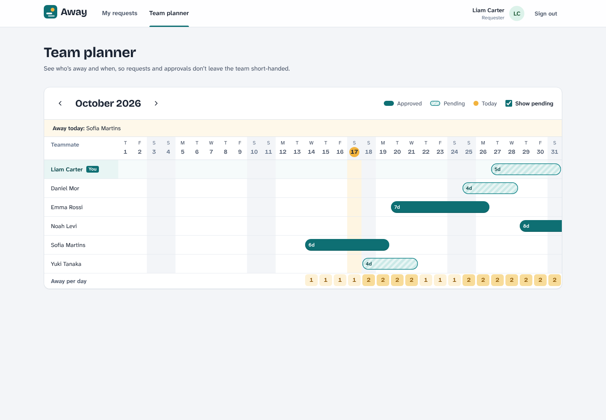
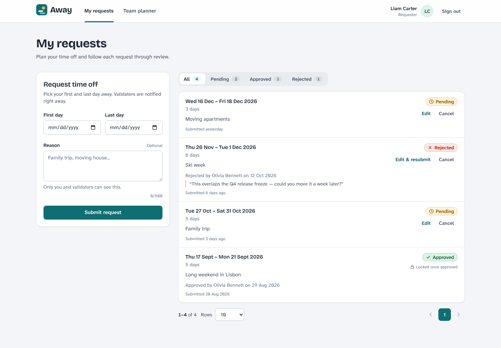
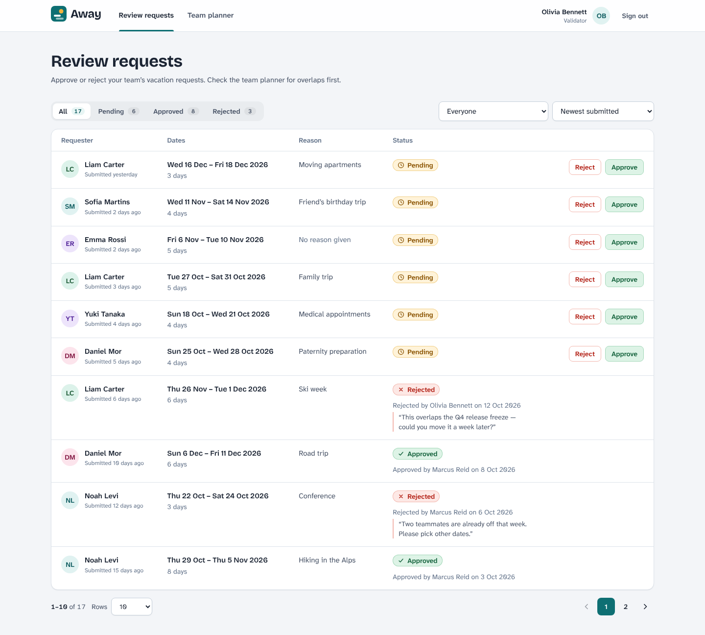
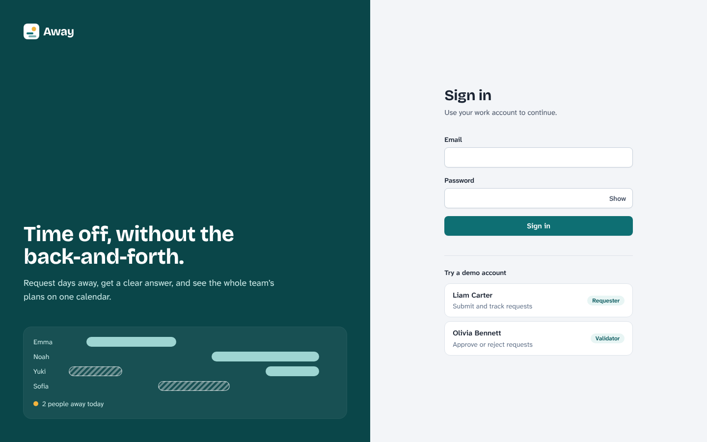
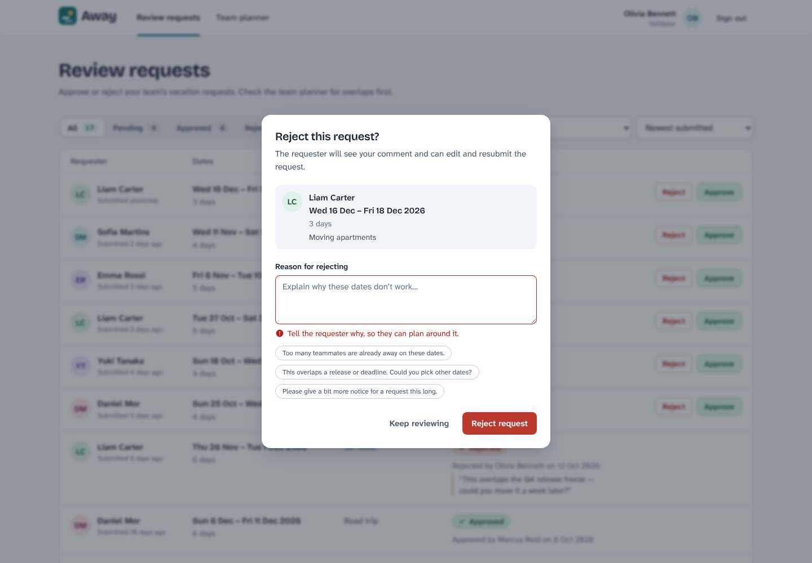
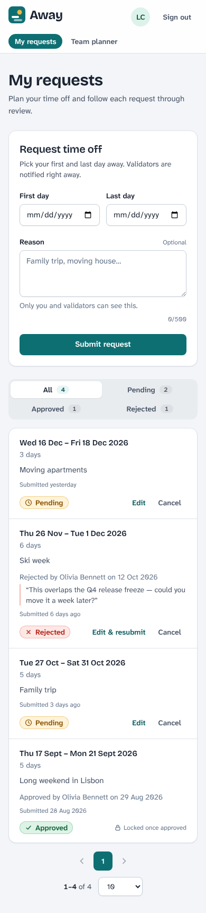
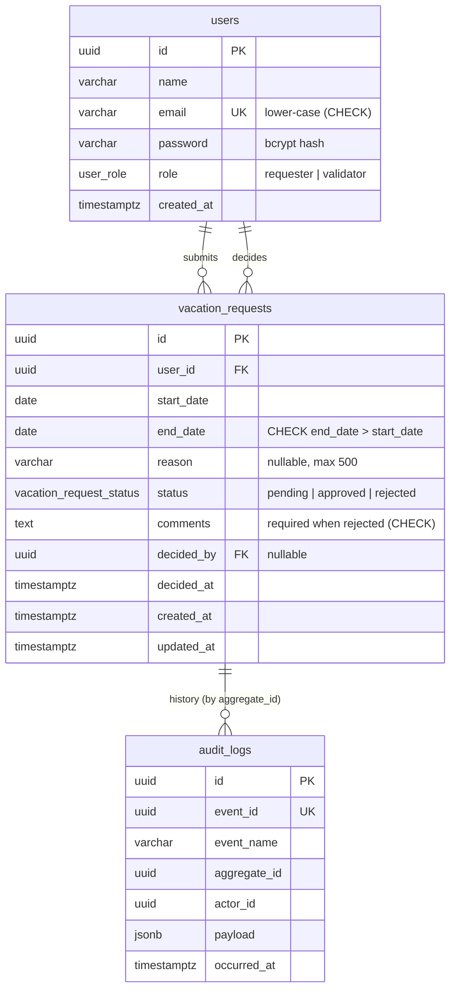
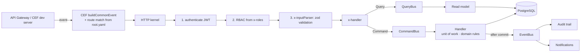

# Away — Vacation Management

A full-stack web application for managing vacation requests. **Requesters** submit and track their time
off, **validators** review, approve or reject requests, and **both** plan around each other on a shared
team calendar.

| Stack    |                                                                                                                                                         |
| -------- | ------------------------------------------------------------------------------------------------------------------------------------------------------- |
| Frontend | Vue 3 (Composition API, `<script setup>`), Vue Router, Pinia, Axios, Tailwind CSS 4, Vite                                                               |
| Backend  | Node.js + TypeScript on the **Common Event Framework**, CQRS (commands / queries / events)                                                              |
| Data     | PostgreSQL 16 + TypeORM (hand-written migrations, constraint-backed business rules)                                                                     |
| Quality  | 160 automated tests: Vitest unit + real-database e2e (incl. race conditions), Playwright browser flows, axe-core WCAG 2.1 AA gate; ESLint, Prettier, CI |



<details>
<summary>More screenshots</summary>

| Requester                                        | Validator                                     |
| ------------------------------------------------ | --------------------------------------------- |
|  |         |
|            |  |



</details>

---

## Contents

1. [Quick start](#quick-start)
2. [Features](#features)
3. [Database setup](#database-setup)
4. [Scripts](#scripts)
5. [Architecture](#architecture)
6. [API](#api)
7. [Business rules](#business-rules)
8. [Testing](#testing)
9. [Technical decisions](#technical-decisions)
10. [Security](#security)
11. [Known limitations & next steps](#known-limitations--next-steps)

---

## Quick start

**Prerequisites:** Node.js **24 LTS** (or 22.22.2+; npm 10+) and either **Docker** _or_ a local **PostgreSQL 13+**.

```bash
# 1. Install all workspaces (backend + frontend)
npm install

# 2. Create the backend configuration
cp backend/.env.example backend/.env          # Windows: copy backend\.env.example backend\.env

# 3. Start PostgreSQL (Docker) — or see "Database setup" for a local install
npm run db:up

# 4. Create the schema and load demo data
npm run setup

# 5. Run the API and the web app together
npm run dev
```

| URL                          | What                                                       |
| ---------------------------- | ---------------------------------------------------------- |
| http://localhost:5173        | Web app                                                    |
| http://localhost:3000/doc    | Interactive API documentation (generated from `root.yaml`) |
| http://localhost:3000/api/v1 | REST API                                                   |

**Demo accounts** — password `Password123!` for every account (one-click buttons on the sign-in page):

| Role      | Email                   | Name           |
| --------- | ----------------------- | -------------- |
| Requester | `requester@example.com` | Liam Carter    |
| Validator | `validator@example.com` | Olivia Bennett |

Five more requesters (`emma.rossi@`, `noah.levi@`, `yuki.tanaka@`, `sofia.martins@`, `daniel.mor@example.com`)
and a second validator (`marcus.reid@example.com`) populate the team planner. Seed dates are relative to
_today_, so the data always looks current.

---

## Features

### Authentication

- `POST /api/v1/auth/login` issues a signed **JWT** (HS256, issuer/audience-checked, 8h by default).
- **Protected routes** on both sides: API routes require a bearer token; Vue Router guards redirect to
  sign-in (remembering the requested URL) and keep each role on its own pages.
- **Role-based access control** with two roles — `requester` and `validator` — declared per route in
  the API contract (see [RBAC](#rbac-declared-in-the-contract)).
- Brute-force protection: 5 failed logins within 15 minutes lock further attempts for 15 minutes
  (`429` + `Retry-After`). Behind a trusted proxy (`TRUST_PROXY=true`) the lock is per account _and_
  client IP, so a stranger cannot lock a colleague out.

### Requester interface (`/my-requests`)

- Form with **start date**, **end date** (required) and **reason** (optional), with instant validation,
  a live summary (“5 days away (3 working days). Back on Mon 2 Nov.”) and clear server errors — an
  overlap lists the exact conflicting request.
- Paginated list of the requester's own requests with **Pending / Approved / Rejected** status, the
  validator's comment, and status filter tabs that double as counters.
- **Edit** or **cancel** pending requests; editing a **rejected** request re-submits it for review;
  **approved requests are locked**.

### Validator interface (`/review`)

- Dashboard of **all** requests, **filterable by status and by user**, sortable (newest submitted /
  soonest start), with **pagination** and page-size control. Filters live in the URL (shareable,
  survive reloads, work with the back button).
- **Approve** (optional note) or **reject** (comment **required**, with quick-pick suggestions) from a
  confirmation dialog showing the request summary.

### Team planning (`/team`, both roles)

- Month “wall planner”: one row per teammate, approved time off as solid bars, pending as hatched bars,
  weekends shaded, today highlighted, plus an **“Away per day”** coverage row and an
  “Away today” summary. Reasons and comments are never exposed to colleagues.

---

## Database setup

### Option A — Docker (recommended)

`npm run db:up` starts `postgres:16-alpine` (see [`docker-compose.yml`](docker-compose.yml)) with:

- user / password `vacation` / `vacation`, database `vacation_manager` on port `5432`
- a second database, `vacation_manager_test`, for the e2e test-suite (created by `docker/postgres/init`)

These match the defaults in `backend/.env.example`. Stop it with `npm run db:down`.

### Option B — Local PostgreSQL

```sql
-- as a superuser (e.g. psql -U postgres)
CREATE ROLE vacation LOGIN PASSWORD 'vacation';
CREATE DATABASE vacation_manager OWNER vacation;
CREATE DATABASE vacation_manager_test OWNER vacation;  -- only needed for npm run test:e2e
```

The migration enables two standard contrib extensions, `pgcrypto` and `btree_gist`. Both ship with
PostgreSQL and are “trusted”, so the database owner can enable them — no superuser needed. Adjust
`DB_*` in `backend/.env` if your credentials differ.

### Migrations & seed

```bash
npm run db:migrate     # apply pending migrations
npm run db:seed        # demo data (skips if users exist; add -- --force to wipe and reseed)
npm run db:reset       # drop everything, migrate, seed
npm run db:revert -w backend   # roll back the last migration
```

The schema is changed **only** through migrations (`synchronize` is always off). An e2e test asserts
that the migrations and the entity metadata never drift apart.

### Schema



Key design points:

- **`EXCLUDE USING gist (user_id WITH =, daterange(start_date, end_date, '[]') WITH &&) WHERE (status <> 'rejected')`**
  makes overlapping pending/approved requests for one user _impossible_, even under concurrent writes.
- Indexes follow the access paths: `(user_id, start_date)` for the requester list, `(status, created_at)`
  and `(created_at)` for the dashboard. Team-calendar range queries use the same
  `daterange … &&` expression as the exclusion constraint, which keeps them GiST-indexable.
- Pagination is offset-based with a deterministic tie-breaker (`ORDER BY <sort>, id`) and a single
  `COUNT` — the right trade-off for dashboards that jump to arbitrary pages.

---

## Scripts

Run from the repository root:

| Command                           | Description                                                                                     |
| --------------------------------- | ----------------------------------------------------------------------------------------------- |
| `npm run dev`                     | API (port 3000, hot reload) + web app (port 5173, proxied API)                                  |
| `npm run build`                   | Compile the API (`backend/dist`) and bundle the web app (`frontend/dist`)                       |
| `npm start`                       | Preview the compiled API locally (production target: AWS Lambda, see `build:lambda`)            |
| `npm test`                        | Unit tests (backend + frontend) — no database needed                                            |
| `npm run test:e2e`                | API end-to-end tests against PostgreSQL (`vacation_manager_test`, wiped on each run)            |
| `npm run test:browser`            | Browser flows + accessibility audit (Playwright). First time: `npm run install-browsers -w e2e` |
| `npm run lint`                    | ESLint (both workspaces)                                                                        |
| `npm run typecheck`               | `tsc` / `vue-tsc`                                                                               |
| `npm run format`                  | Prettier                                                                                        |
| `npm run codegen`                 | Regenerate the CEF handler registry and the frontend API types from `root.yaml`                 |
| `npm run build:lambda -w backend` | Bundle a deployable AWS Lambda zip (`backend/dist/dist.zip`)                                    |

---

## Architecture

```
vacation-manager/
├── backend/                     Node.js API (Common Event Framework)
│   └── src/
│       ├── index.ts             Lambda handler + local server (CEF entry point)
│       ├── root.yaml            OpenAPI contract: routing, validation hooks, RBAC, docs
│       ├── generated/           HandlerRegistry (generated from root.yaml)
│       ├── handlers/            Thin HTTP adapters: parse input → dispatch command/query
│       ├── http/                Kernel on top of CEF: auth, RBAC, validation, errors, headers
│       ├── bootstrap/           Composition root (dependency wiring)
│       ├── config/              Validated environment configuration
│       ├── core/                CQRS buses, errors, clock, dates, pagination, ports
│       ├── infrastructure/      TypeORM data source, migrations, seed, unit of work, notifier
│       └── modules/
│           ├── auth/            Authenticate command, JWT, bcrypt, login throttling
│           ├── users/           User entity, repository, queries
│           ├── vacation-requests/
│           │   ├── domain/      Aggregate, VacationPeriod value object, errors, statuses
│           │   ├── application/ Commands, queries, events, subscribers, ports, DTOs
│           │   └── infrastructure/ TypeORM repository (write) + read model (queries)
│           └── audit/           Audit-trail entity + event subscriber
├── frontend/                    Vue 3 SPA
│   └── src/
│       ├── api/                 Axios client, endpoint wrappers, generated OpenAPI types
│       ├── components/ui/       Reusable kit: buttons, fields, tabs, pagination, dialog, toasts…
│       ├── components/vacation/ Request form, lists, review table, decision dialog
│       ├── components/planner/  Team planner
│       ├── composables/         useAsync (race-safe loading), useQueryState (URL-synced filters)
│       ├── stores/              Pinia: auth session, toasts
│       ├── router/              Routes + role guards
│       └── views/               Login, My requests, Review, Team planner, 404
├── e2e/                         Playwright browser flows + axe-core accessibility audit
└── docker-compose.yml           PostgreSQL for local development
```

### Request pipeline



### How the Common Event Framework is used

[`commoneventframework`](https://www.npmjs.com/package/commoneventframework) normalises AWS events
(API Gateway v1/v2, SQS, S3, direct invocation) into a single `CommonEvent` and routes it to handlers
declared in an OpenAPI file. This project uses it as the HTTP foundation:

- **`root.yaml` is the single executable contract.** Every route declares its `x-handler` and
  `x-inputParser`; `scripts/codegen.cjs` generates the static `HandlerRegistry` from it.
- **One code path everywhere.** `src/index.ts` exports a Lambda `handler`; `npm run dev` serves the very
  same handler through CEF's local server (`--local`), and the e2e tests invoke it directly — including
  with an API Gateway v2 event to prove Lambda compatibility. `npm run build:lambda -w backend` produces
  a deployable zip with CEF's bundler.
- **Free API docs**: CEF serves the contract as interactive docs at `/doc` (disabled in production,
  together with the framework's `/context` and `/dependencies` introspection routes).
- An **HTTP kernel** (`src/http/http-kernel.ts`) adds what the framework doesn't provide: authentication,
  RBAC, uniform JSON errors, security & CORS headers, request ids and structured access logs.

#### RBAC declared in the contract

```yaml
/api/v1/vacation-requests/:id/approve:
  post:
    x-roles: [validator] # authenticated + role check
    x-handler: handlers/vacation-requests#approveVacationRequest
    x-inputParser: handlers/vacation-requests#parseDecision
/api/v1/auth/login:
  post:
    security: [] # explicitly public
```

Secure by default: the API refuses to start if a protected operation forgets `x-roles`, and unknown
routes fail closed. Authentication and RBAC run **before** input validation, so anonymous callers
never learn the request schema.

### Commands, queries and events

The write side and read side are separated (CQRS-lite) through three buses in `src/core/cqrs`:

| Commands (intent — change state) | Domain events (fact — published after commit) | Queries (read only)              |
| -------------------------------- | --------------------------------------------- | -------------------------------- |
| `AuthenticateUserCommand`        |                                               | `GetUserQuery`, `ListUsersQuery` |
| `CreateVacationRequestCommand`   | `VacationRequestSubmittedEvent`               | `ListVacationRequestsQuery`      |
| `UpdateVacationRequestCommand`   | `VacationRequestUpdatedEvent`                 | `GetVacationRequestQuery`        |
| `CancelVacationRequestCommand`   | `VacationRequestCancelledEvent`               | `GetVacationRequestStatsQuery`   |
| `ApproveVacationRequestCommand`  | `VacationRequestApprovedEvent`                | `GetTeamCalendarQuery`           |
| `RejectVacationRequestCommand`   | `VacationRequestRejectedEvent`                |                                  |

- Commands carry a phantom result type, so `commandBus.execute(new X(...))` is fully type-inferred.
  A middleware chain wraps every command (logging/timing today; tracing or metrics tomorrow).
- Command handlers run inside a **unit of work** (one transaction, row locks where decisions are made)
  and depend only on **ports** (`VacationRequestRepository`, `UnitOfWork`, `Clock`, `EventPublisher`), so
  they are unit-tested with in-memory fakes.
- Events are published **only after the transaction commits**. Subscribers are isolated: a failing
  subscriber is logged and never breaks the request or the other subscribers.
  - `AuditTrailSubscriber` stores every event in `audit_logs` (idempotent on `event_id`).
  - `NotifyValidatorsOfPendingRequest` / `NotifyRequesterOfDecision` send notifications through a
    `Notifier` port (logged in development).
- Swapping the in-process bus for SQS/SNS needs no change to command handlers — and CEF already routes
  SQS events, so consumers would simply be new `x-handler` routes.

### Frontend

- **Contract-first types**: `npm run codegen:api` generates TypeScript types from the backend's
  `root.yaml` (`openapi-typescript`). An API change that breaks the UI fails the build, not production.
- **Thin views, reusable pieces**: views orchestrate; `components/ui` is a small accessible kit;
  `useAsync` discards out-of-order responses; `useQueryState` keeps filters and pagination in the URL.
- **Errors are data**: every API failure becomes an `ApiError` with `code`, `message` and per-field
  messages, so forms highlight the exact field the server rejected.
- **Design**: a calm “paper and ink” palette with a lagoon accent, Atkinson Hyperlegible Next for UI text
  (chosen for legibility) and Bricolage Grotesque for headings, self-hosted via Fontsource. Status is
  always conveyed by text + icon, not colour alone; native `<dialog>` for focus management; visible
  focus rings, skip link, reduced-motion support, responsive down to phone widths.

---

## API

Base path `/api/v1`. Full, interactive reference at **http://localhost:3000/doc**.

| Method   | Path                             | Roles     | Description                                                  |
| -------- | -------------------------------- | --------- | ------------------------------------------------------------ |
| `GET`    | `/health`                        | public    | API + database health                                        |
| `POST`   | `/auth/login`                    | public    | Credentials → JWT                                            |
| `GET`    | `/auth/me`                       | both      | Current user                                                 |
| `GET`    | `/me/vacation-requests`          | requester | Own requests (`status`, `page`, `pageSize`, `sort`, `order`) |
| `GET`    | `/me/vacation-requests/stats`    | requester | Own counts per status                                        |
| `POST`   | `/vacation-requests`             | requester | Submit a request → `201` + `Location`                        |
| `GET`    | `/vacation-requests`             | validator | All requests (+ `userId` filter)                             |
| `GET`    | `/vacation-requests/stats`       | validator | Counts per status                                            |
| `GET`    | `/vacation-requests/:id`         | both      | One request (requesters: own only)                           |
| `PUT`    | `/vacation-requests/:id`         | requester | Modify own pending/rejected request                          |
| `DELETE` | `/vacation-requests/:id`         | requester | Cancel own pending/rejected request → `204`                  |
| `POST`   | `/vacation-requests/:id/approve` | validator | Approve (optional `comment`)                                 |
| `POST`   | `/vacation-requests/:id/reject`  | validator | Reject (`comment` required)                                  |
| `GET`    | `/team-calendar?from=&to=`       | both      | Pending + approved vacations in a window                     |
| `GET`    | `/users?role=`                   | validator | Users (dashboard filter)                                     |

Paginated responses: `{ "data": [...], "meta": { "page", "pageSize", "totalItems", "totalPages" } }`.

Errors always share one shape and a stable machine-readable code:

```json
{
  "error": {
    "code": "VACATION_OVERLAP",
    "message": "These dates overlap with another of your pending or approved vacation requests.",
    "details": [
      {
        "message": "Overlaps 2030-02-01 → 2030-02-05 (pending)",
        "startDate": "2030-02-01",
        "...": "..."
      }
    ],
    "requestId": "4f6c…"
  }
}
```

| Status  | Codes                                                                                                   |
| ------- | ------------------------------------------------------------------------------------------------------- |
| 400     | `MALFORMED_JSON`                                                                                        |
| 401     | `MISSING_TOKEN`, `INVALID_TOKEN`, `TOKEN_EXPIRED`, `INVALID_CREDENTIALS`                                |
| 403     | `INSUFFICIENT_ROLE`, `VALIDATOR_ROLE_REQUIRED`, `REQUESTER_ROLE_REQUIRED`, `NOT_REQUEST_OWNER`          |
| 404     | `ROUTE_NOT_FOUND`, `VACATION_REQUEST_NOT_FOUND`                                                         |
| 409     | `VACATION_OVERLAP`, `REQUEST_NOT_MODIFIABLE`, `REQUEST_ALREADY_DECIDED`                                 |
| 413/415 | `PAYLOAD_TOO_LARGE`, `UNSUPPORTED_MEDIA_TYPE`                                                           |
| 422     | `VALIDATION_ERROR`, `END_DATE_NOT_AFTER_START_DATE`, `START_DATE_IN_PAST`, `REJECTION_COMMENT_REQUIRED` |
| 429     | `LOGIN_LOCKED` (with `Retry-After`)                                                                     |

---

## Business rules

Each rule is enforced in the domain (so it holds for any entry point), backed by the database where
possible, mirrored in the UI for instant feedback, and covered by tests.

| #   | Rule                                 | Domain / application                                                                 | Database                                             | Tests                                      |
| --- | ------------------------------------ | ------------------------------------------------------------------------------------ | ---------------------------------------------------- | ------------------------------------------ |
| 1   | End date after start date            | `VacationPeriod.create`                                                              | `CHECK (end_date > start_date)`                      | unit + e2e                                 |
| 2   | No overlapping requests per user     | `assertNoOverlap` policy (lists conflicts)                                           | `EXCLUDE USING gist …` (race-proof)                  | unit + e2e incl. 6 concurrent submissions  |
| 3   | Approved requests cannot be modified | `VacationRequest.assertModifiable` (edit & cancel); decisions only on pending        | row lock (`SELECT … FOR UPDATE`)                     | unit + e2e incl. concurrent approve/reject |
| 4   | No requests in the past              | `VacationPeriod.create` with an injectable `Clock` in `APP_TIMEZONE` (today allowed) | —                                                    | unit + e2e                                 |
| 5   | Rejection requires a comment         | `VacationRequest.reject`                                                             | `CHECK (status <> 'rejected' OR comments non-blank)` | unit + e2e                                 |
| 6   | Only validators approve/reject       | route `x-roles` **and** `assertIsValidator` in the command handlers                  | —                                                    | unit + e2e                                 |

---

## Testing

| Suite                                | Scope                                                                                                                                                                                                                                                                                     | Count |
| ------------------------------------ | ----------------------------------------------------------------------------------------------------------------------------------------------------------------------------------------------------------------------------------------------------------------------------------------- | ----- |
| Backend unit (`npm test -w backend`) | Domain rules, command handlers with in-memory ports, buses, JWT/authentication, login throttling, configuration, input parsing, route security                                                                                                                                            | 72    |
| Backend e2e (`npm run test:e2e`)     | Real PostgreSQL + migrations, requests through the Lambda handler: auth, RBAC, every business rule, pagination & filters, team calendar, audit trail, race conditions, schema drift, API Gateway v2 events                                                                                | 34    |
| Frontend (`npm test -w frontend`)    | Date utilities, API error mapping, form validation, components (incl. keyboard behaviour), team planner, route guards, auth store                                                                                                                                                         | 30    |
| Browser (`npm run test:browser`)     | Real Chromium against a real API + database, desktop and mobile: sign-in & role guards, full request life-cycle across both roles, URL-synced filters, team planner, and an **axe-core WCAG 2.1 AA audit of every screen and dialog**. Fails on any Vue runtime warning or uncaught error | 24    |

Both database-backed suites refuse to run against a database whose name does not end in `_test`, and
the browser suite starts its own API and web server on separate ports (3100 / 5174), so it never
touches development data. CI (`.github/workflows/ci.yml`) runs formatting, lint, typecheck, all test
suites against PostgreSQL services, and both production builds.

---

## Technical decisions

- **CQRS-lite over a classic service layer.** Commands, queries and events make the architecture
  visible and give every use case one obvious home. Full event sourcing would be overkill here: state
  lives in tables, and events drive side effects and the audit trail.
- **Rich aggregate + value object.** `VacationRequest` only changes through intention-revealing methods
  (`submit`, `reschedule`, `approve`, `reject`), and `VacationPeriod` cannot exist in an invalid state.
  TypeORM entities double as aggregates. That is a pragmatic choice, documented rather than hidden behind
  a separate persistence model.
- **Database as the last line of defence.** Business rules live in the domain, but the critical ones are
  also database constraints. Application checks give friendly errors; constraints guarantee correctness
  under concurrency.
- **Dates as `YYYY-MM-DD` strings.** A vacation day is a calendar day, not an instant. Avoiding JS `Date`
  objects for calendar dates removes a whole class of time-zone bugs, and "today" is computed in a
  configurable `APP_TIMEZONE`.
- **Explicit composition root, no DI container.** The wiring fits in one readable file, and tests swap
  any port.
- **TypeORM 1.x with hand-written migrations** and explicit entity/migration registration (no globs),
  so the same configuration works under `tsx`, compiled `node`, a bundler and the test runner.
- **`bcryptjs` and `pg` are pure JavaScript**, so there are no native builds and installation is the same
  on Windows, macOS and Linux.
- **Re-reading the user on each request.** The JWT proves identity, but the role is loaded from the
  database, so role changes and deleted accounts take effect immediately.
- **Interpretations of the brief:**
  - _“End date must be after start date”_ is applied literally (strictly after), so single-day requests
    are not possible. Relaxing this is a one-line change in `VacationPeriod` plus a CHECK-constraint
    migration.
  - The “team” is everyone with the requester role. There is no team entity in the required schema.
  - Requesters can edit pending requests. Editing a rejected request resubmits it. Cancelling a request
    deletes it, and the audit trail keeps its history. Validators review but don't submit requests.
  - A request's length is counted in calendar days. Working days are shown in the UI only.

---

## Security

- JWT: HS256 only (`alg: none` / algorithm confusion rejected), issuer + audience + expiry verified,
  secret length enforced at start-up, and the published placeholder secret is refused in production.
- Passwords hashed with bcrypt and never selected by default. Login uses the same generic error and
  timing whether the e-mail exists or not. Failed attempts are throttled in a fixed window with bounded
  memory, per account + client IP behind a trusted proxy (`TRUST_PROXY`).
- Input validated with zod (shape) and the domain (rules). Body size limited to 64 KB, JSON only.
  All SQL is parameterised.
- Security headers on every response (`nosniff`, `X-Frame-Options: DENY`, `Referrer-Policy`,
  `Cache-Control: no-store`), explicit CORS origin, and a request id echoed for support.
- Requesters can't read other people's requests (`404`, no existence leak). The team calendar never
  exposes reasons or comments. Logs redact passwords and tokens. Unexpected errors return a generic 500
  while the details are logged. If the database is unreachable at start-up, requests get a retryable
  `503`.
- The frontend only follows same-app redirects after login (no open redirect) and signs out
  automatically when the token expires or the API returns `401`.

---

## Known limitations & next steps

- **Token storage.** The access token lives in `localStorage` (simple, and works cross-origin), which
  is readable by injected scripts if an XSS bug ever existed. Hardening: `httpOnly` `SameSite` cookies
  with CSRF protection, short-lived access tokens plus refresh-token rotation, and server-side revocation.
- **Account lock-out without a trusted proxy.** When the client IP isn't known (`TRUST_PROXY=false`),
  failed logins are throttled per account, so someone who knows a colleague's e-mail can lock them out
  for 15 minutes. Production deployments behind API Gateway/ALB should set `TRUST_PROXY=true`, plus
  gateway-level rate limiting against distributed guessing.
- **Single-instance assumptions.** The login throttle and the event bus are in-process. For horizontal
  scaling or Lambda, back the throttle with Redis/DynamoDB and publish events through a
  **transactional outbox** to SQS/SNS. Today an event can be lost if the process dies between commit
  and publish (the request itself is safe).
- **Scope.** No user registration or management UI (users are seeded), no leave balances, public
  holidays or per-country calendars, no real e-mail delivery (the `Notifier` port logs), English only.
- **Time zone.** “Today” follows `APP_TIMEZONE` on the server, while the date pickers use the browser's
  local date. Users far from that zone may see the server reject a date the UI allowed (with a clear
  message).
- **Offset pagination** is ideal for page-jumping dashboards but would move to keyset pagination for
  very large tables.
- **Framework quirks (Common Event Framework 1.0.x)**, handled in this codebase:
  - The router requires `:param` paths, so `root.yaml` is not strictly OpenAPI-valid for path templating.
  - The `cef-gen-handlers` bin silently does nothing when launched through a POSIX symlink, so
    `scripts/codegen.cjs` calls the generator directly.
  - The dev server doesn't URL-decode query strings (decoded in `http/request.ts`).
  - The framework's `Response` CORS defaults omit `PATCH`, so updates use `PUT` with the full resource.
  - The dev server binds to `localhost` only and prints a few debug lines per request.
- **Not included:** dark mode, a full-stack Docker image (only PostgreSQL is containerised), and a
  container-ready HTTP server: `npm start` reuses the framework's dev server (binds `localhost`), the
  production target being AWS Lambda behind API Gateway.
